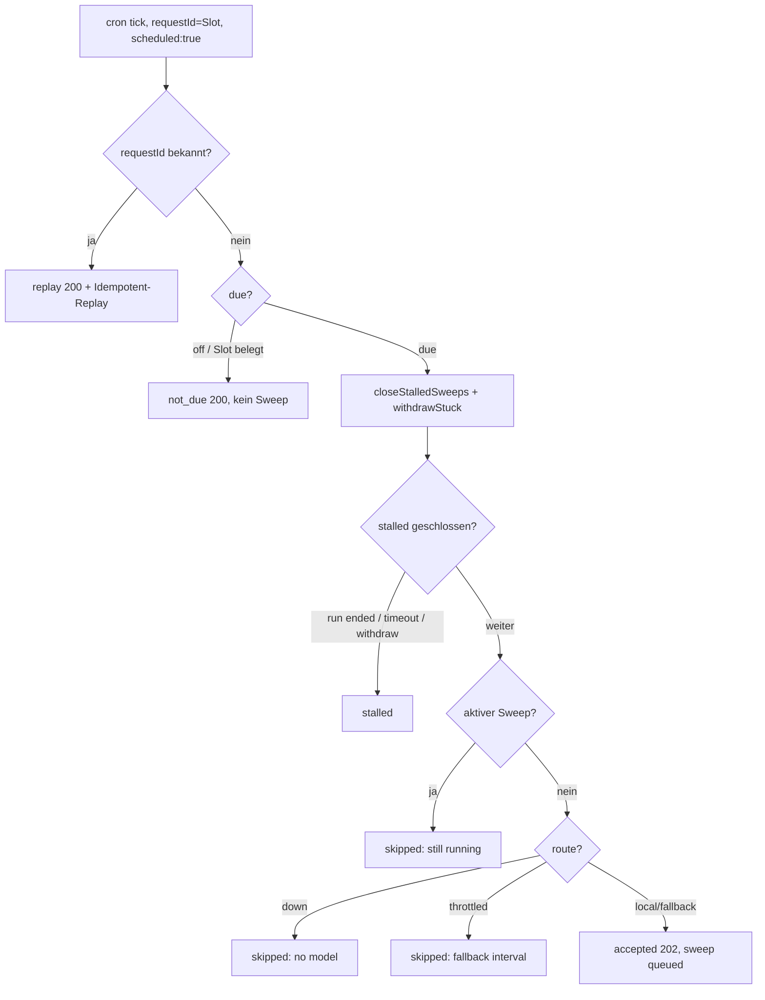

# F3 Sweep-Zweige: Tick-Ablauf, Diagramm und Kurzdoku

Ziel: Jede Kante des Sweep-Tick-Ablaufs hat einen `path:line`-Beleg.
Kein Code, nur Docs.

## Tick-Ablauf (Mermaid)

## Zweige mit Belegen

- Statustyp: `StartSweepResult` kennt `accepted|replay|skipped|not_due` —
  `apps/dna-server-api/src/news/sweep.ts:19-25`.
- Tick sendet `requestId`=Slot mit `scheduled:true` —
  `apps/dna-server-cron/src/tick.ts:40-55`.
- replay bei bekannter `requestId` (`byRequest`) —
  `apps/dna-server-api/src/news/sweep.ts:86-90`.
  HTTP-Mapping: `replay` setzt Header `Idempotent-Replay`, Status 200 —
  `apps/dna-server-api/src/routes/workflows.ts:34-38`.
- not_due bei `scheduled && !due.due`, ohne Sweep-Objekt —
  `apps/dna-server-api/src/news/sweep.ts:92-98`.
  `Schedule.due`: off oder Slot belegt —
  `apps/dna-server-api/src/news/schedule.ts:63-72`.
  HTTP-Mapping: `not_due` → 200 —
  `apps/dna-server-api/src/routes/workflows.ts:34`.
- Pro Tick zuerst `closeStalledSweeps` vor dem Running-Check —
  `apps/dna-server-api/src/news/sweep.ts:99`.
- skipped, weil ein Sweep noch läuft —
  `apps/dna-server-api/src/news/sweep.ts:100-115`.
- skipped bei Route `down` (kein Modell mehr übrig) oder `throttled`
  (Fallback-Intervall) — `apps/dna-server-api/src/news/sweep.ts:116-130`.
- accepted-Pfad: `queued` → `submit` → 202 —
  `apps/dna-server-api/src/news/sweep.ts:131-189`;
  HTTP-Mapping `accepted` → 202 —
  `apps/dna-server-api/src/routes/workflows.ts:36-38`.

## stalled-Ursachen (3)

1. Run beendet vor `complete_sweep` (Restart, Abort, Provider-Fehler) —
   `apps/dna-server-api/src/news/sweep.ts:38-48`.
2. Timeout nach `DNA_STALL_MINUTES` ohne Ergebnis —
   `apps/dna-server-api/src/news/sweep.ts:40-47`.
3. `withdrawStuckSweeps`: Sweep steht hinter einem fehlgeschlagenen Run
   in der Queue (`queued-behind-failed-run`) und wird zurückgezogen —
   `apps/dna-server-api/src/news/sweep.ts:56-69`.

## Status-Typ und lastCronAt

- Sweep-Status inkl. `stalled`/`skipped` —
  `apps/shared/packages/dna-sdk/src/api.ts:212-218`.
- `lastCronAt` ignoriert `skipped` —
  `apps/dna-server-api/src/db/repos/sweeps.ts:125-133`.

## Gegenprüfung mit Tests

- replay + skipped bei laufendem Sweep:
  `apps/dna-server-api/tests/sweep-faux.test.ts:133-153`,
  `apps/dna-server-api/tests/workflow.test.ts:17-26`.
- not_due: `apps/dna-server-api/tests/workflow.test.ts:88-92`.
- stalled (run ended) + withdraw:
  `apps/dna-server-api/tests/schedule.test.ts:39-74`,
  `apps/dna-server-api/tests/schedule.test.ts:77-104`.
- Route down / throttled:
  `apps/dna-server-api/tests/model-route.test.ts:97-131`,
  `apps/dna-server-api/tests/model-route.test.ts:133-178`.
- Cron-Replay: `apps/dna-server-cron/tests/tick.test.ts:62-84`.
