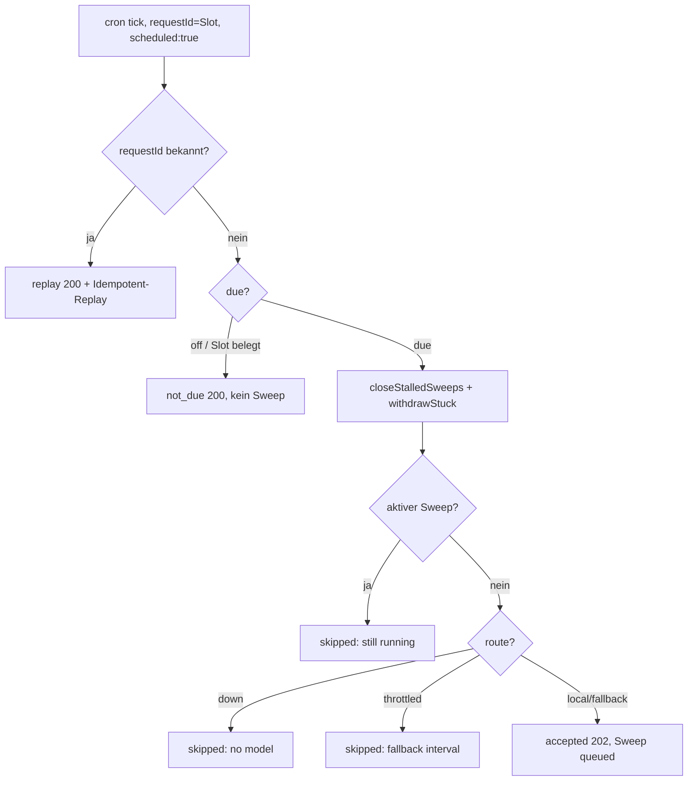

# Sweep-Tick-Zweige (F3)

Jeder Tick (`cron`, `scheduled:true`, `requestId` = Slot) läuft durch
`startNewsSweep`. Vollständige Kantenliste mit Belegen:
`.agents/plans/f3-sweep-zweige/design.md`.

| Zweig | HTTP | Beleg |
|---|---|---|
| `replay` (gleiche `requestId`) | 200 + `Idempotent-Replay` | `apps/dna-server-api/src/news/sweep.ts:86-90`, `apps/dna-server-api/src/routes/workflows.ts:34-38` |
| `not_due` (off / Slot belegt) | 200, kein Sweep | `apps/dna-server-api/src/news/sweep.ts:92-98`, `apps/dna-server-api/src/routes/workflows.ts:34` |
| `skipped` (läuft noch) | 200 | `apps/dna-server-api/src/news/sweep.ts:100-115` |
| `skipped` (`down` / `throttled`) | 200 | `apps/dna-server-api/src/news/sweep.ts:116-130` |
| `accepted` | 202 | `apps/dna-server-api/src/news/sweep.ts:131-189`, `apps/dna-server-api/src/routes/workflows.ts:36-38` |
| `stalled` (run ended / Timeout / withdraw) | DB + Bus | `apps/dna-server-api/src/news/sweep.ts:38-69` |

Tests: `workflow.test.ts` (replay, skipped, not_due), `sweep-faux.test.ts`
(replay + skipped), `schedule.test.ts` (stalled + withdraw),
`model-route.test.ts` (down / throttled), `tick.test.ts` (Cron-Replay).
